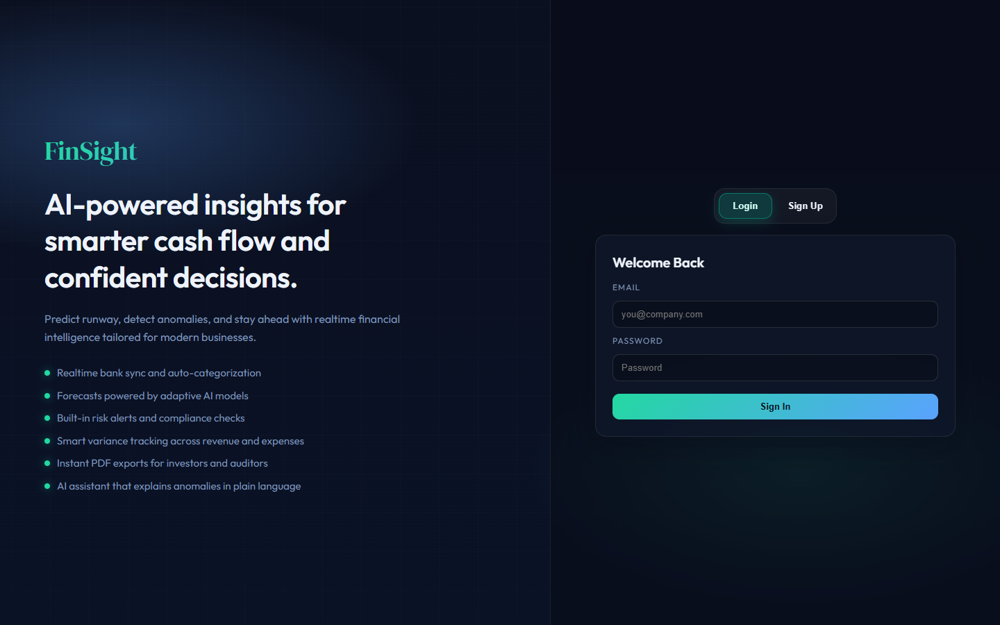
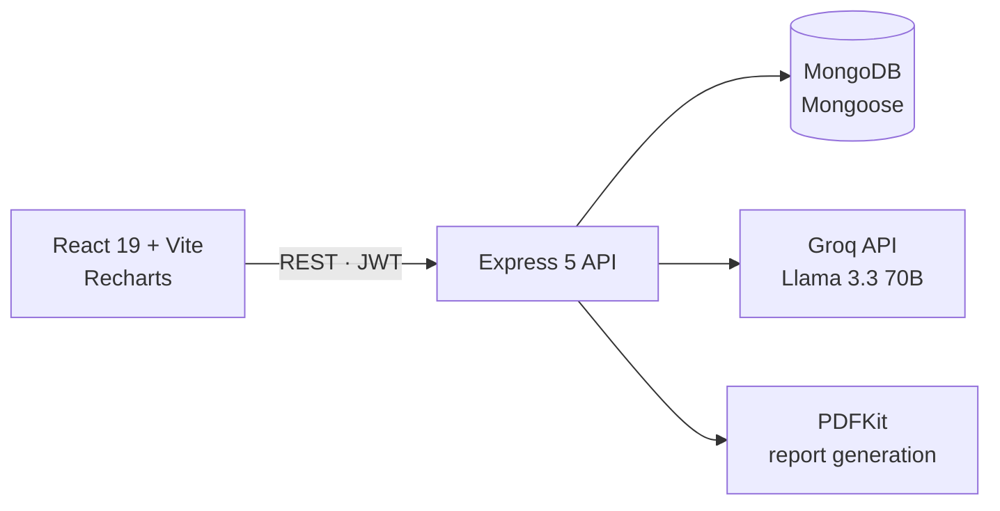

<div align="center">

# FinSight

**An AI-powered financial assistant for small businesses: transaction tracking, cash-flow analytics, anomaly alerts, a natural-language finance chatbot and one-click PDF reports.**


**[Live demo](https://fin-sight-murex.vercel.app/)**

</div>

<br />



---

## Features

| | |
|---|---|
| 📊 **Dashboard** | Revenue, expense and net-profit KPIs, a financial health score, monthly trends and an expense breakdown |
| 💸 **Transactions** | Record and categorize income and expenses |
| 📈 **Cash flow** | Month-by-month cash-flow chart with labeled axes |
| 🚨 **Anomaly alerts** | Flags transactions that are far above a user's historical average |
| 💡 **AI insights** | Summaries of trends and unusual spending patterns |
| 🤖 **AI chatbot** | Ask questions like *"Why is cash flow down this month?"* in plain language (Groq, Llama 3.3 70B) |
| 🧾 **Reports** | Profit & loss and tax summary views |
| 📄 **PDF export** | One-click monthly, yearly or all-time reports (PDFKit) |

## Architecture



The API exposes `/api/auth`, `/api/transactions`, `/api/dashboard`, `/api/insights`, `/api/ai/chat` and `/api/reports/export`. Everything except auth requires a JWT.

## Getting started

**Prerequisites:** Node.js (LTS), a MongoDB connection string and a [Groq](https://console.groq.com) API key.

Create `server/.env`:

```env
MONGO_URI=mongodb+srv://...
JWT_SECRET=change-me
GROQ_API_KEY=gsk_...
CLIENT_URL=http://localhost:5173
```

```bash
# API
cd server
npm install
npm run dev

# Web client (in a second terminal)
cd client
npm install
npm run dev
```

To fill an account with sample transactions, run `node scripts/seedDemo.js --email you@example.com` from `server/`.

## Project structure

```text
client/src/
  pages/        Dashboard, Transactions, Cash Flow, Insights, Chatbot, P&L, Tax Summary
  components/   KPI grid, charts, health score, chat, sidebar
server/
  routes/ · controllers/   REST endpoints
  services/     AI assistant, insights, anomaly detection, dashboard aggregation
  models/       User, Transaction (Mongoose)
  scripts/      demo data seeding
```

## Team

FinSight is a team project, originally developed in [Lakshya080805/FinSight](https://github.com/Lakshya080805/FinSight).

- **Lakshya Singhal:** lead developer
- **Rohan Tiwari:** contributor

## License

Proprietary. All rights reserved.
